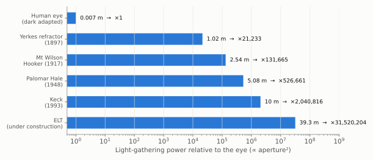
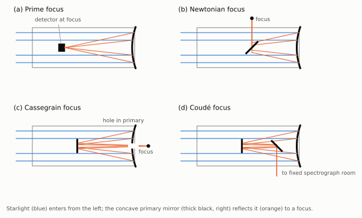

# Chapter 1: Methods in Observational Astronomy

Almost everything we know about the Universe beyond the Solar System has arrived as light. Astronomy is therefore the art of collecting as much of that light as possible, and of squeezing every bit of information out of it: how bright the source is, what colour it is, and which wavelengths are missing from its spectrum.

## 1.1 Astronomical Telescopes

Telescopes can use either refraction (lenses) or reflection (mirrors) to gather light over a large collecting surface and bring it to a focus on a much smaller area. This ability to gather light, and not magnification, is the primary purpose of an astronomical telescope.

Two numbers describe what a telescope can do, and both depend on the diameter *D* of its main lens or mirror:

> **Light-gathering power ∝ D²** (the collecting area)
>
> **Smallest resolvable angle θ ≈ 1.22 λ / D** (the diffraction limit)

Doubling the aperture collects four times the light, so stars four times fainter become visible.

*Figure 1.1. Light-gathering power grows as the square of the aperture. The 40-inch (1.02 m) Yerkes refractor of 1897 is still the largest lens telescope ever used for astronomy; every larger telescope is a reflector.*

### Why reflectors won

Refracting telescopes have serious drawbacks. A lens bends different colours by different amounts (*chromatic aberration*), so the images have coloured fringes. A lens can be supported only at its edge, so a large lens sags under its own weight. And light must pass through the glass, which absorbs some of it, particularly in the ultraviolet. The 1-metre Yerkes lens reached the practical limit.

A mirror has none of these problems: reflection treats all colours alike, and a mirror can be supported across its entire back. For these reasons all large modern telescopes are reflectors.

### Reflecting telescopes

The main element of a reflecting telescope is a concave mirror with a *paraboloidal* surface, which brings all light from a distant point source to a single focus. Because secondary mirrors can easily redirect the beam, several different focal arrangements are possible, each with a different focal ratio. This lets a single telescope serve several different purposes efficiently.

*Figure 1.2. Focal arrangements of a reflecting telescope. (a) **Prime focus**: the detector sits in the beam, in front of the primary mirror; this gives the widest field. (b) **Newtonian**: a flat diagonal mirror sends the beam out of the side of the tube. (c) **Cassegrain**: a convex secondary mirror sends the beam back through a hole in the primary; this gives a long focal length in a short tube. (d) **Coudé**: extra flat mirrors send the beam to a fixed room, where heavy spectrographs can be mounted that would be impossible to swing around with the telescope.*

## 1.2 Detectors: from the Eye to the CCD

Gathering light is only half the job; it must also be recorded.

- **Photographic plates** (from the 1880s) allowed exposures of many hours, accumulating light that the eye could never see. Hubble's discoveries in Chapter 3 were all made on photographic plates. But a plate records only about 1–2% of the photons that fall on it.
- **Charge-coupled devices (CCDs)**, adopted by astronomers from the late 1970s, record up to about 90% of the photons and give a direct digital measurement of brightness. A modest telescope with a CCD can outperform a giant one using plates.

## 1.3 Spectroscopy

A spectrograph spreads the light from a star or galaxy into its component wavelengths. The resulting spectrum is the single most informative thing an astronomer can measure:

- its overall shape gives the **temperature** of the source (Chapter 2);
- dark **absorption lines** at characteristic wavelengths reveal the **chemical composition**;
- a shift of those lines from their laboratory wavelengths gives the **velocity** of the source along the line of sight, through the Doppler effect. This is how the expansion of the Universe was discovered (Chapter 3).

## 1.4 Beyond Visible Light

The atmosphere is transparent to visible light and to radio waves, but blocks most other wavelengths. **Radio telescopes**, developed after the Second World War, opened the second window. They found the radio galaxies and quasars of Chapter 4 and the cosmic microwave background of Chapter 7. **Space telescopes** avoid the atmosphere entirely. The Hubble Space Telescope (launched 1990) and the James Webb Space Telescope (launched 2021) have produced many of the results described in Chapter 11.
