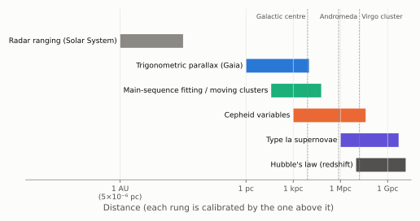
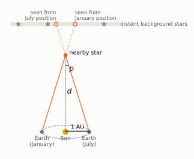
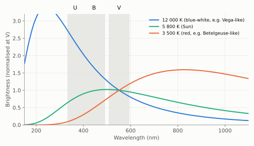
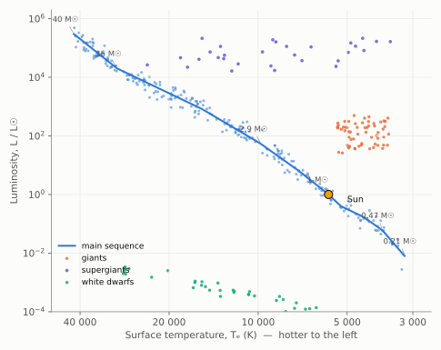
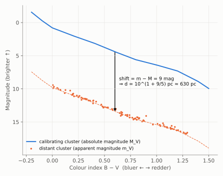
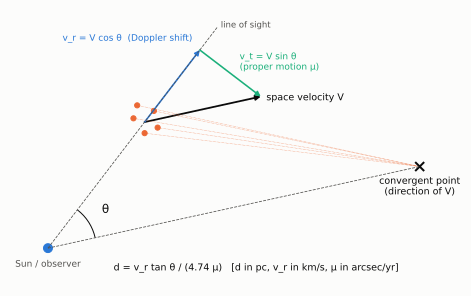
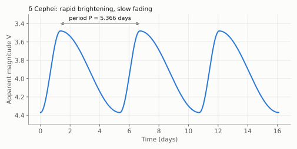
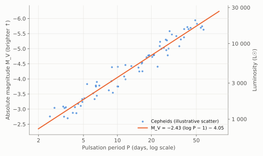

# Chapter 2: Estimating the Distance Scale of the Universe

Measuring how far away things are is the hardest basic problem in astronomy. A star looks like a point of light whether it is near and faint or far and luminous. No single method works at every distance. Instead, astronomers have built a **distance ladder**: each method is calibrated using the one below it and then reaches further out.

*Figure 2.1. The rungs of the distance ladder and the range over which each works. Overlaps between rungs are what allow each one to be calibrated from the one above it in this chart.*

A useful bookkeeping quantity throughout this chapter is the **distance modulus**. If *m* is a star's apparent magnitude (how bright it looks) and *M* its absolute magnitude (how bright it would look from 10 parsecs), then

> **m − M = 5 log₁₀ (d / 10 pc)**

Magnitudes run backwards, so smaller numbers mean brighter. A difference of 5 magnitudes is a factor of 100 in brightness. Knowing *m − M* is the same as knowing the distance.

## 2.1 Trigonometric Parallax

This is the oldest and most direct method, and the foundation of the whole ladder. As the Earth moves around the Sun, a nearby star appears to shift back and forth against much more distant background stars. Six months apart, the Earth is at opposite ends of a baseline 2 AU long.

*Figure 2.2. Trigonometric parallax. The parallax angle p is half the total shift seen over six months. The star appears projected to the right of its mean position when seen from one side of the orbit, and to the left from the other.*

Treating the background stars as infinitely far away, simple geometry gives the distance:

> **d = 1 AU / p** (p in radians)

Astronomers define the **parsec** (pc) as the distance at which *p* = 1 arcsecond, so that

> **d (pc) = 1 / p (arcsec)**,   1 pc = 3.26 light-years = 206 265 AU.

The angles are tiny. Even the nearest star, Proxima Centauri, has *p* = 0.77″, the size of a coin seen from 5 km away. From the ground, through a shimmering atmosphere, parallaxes could be measured reliably only for stars within about 100 pc (around 300 light-years). Measurements from space changed that. The Hipparcos satellite (1989–93) reached about 1 milliarcsecond. The Gaia satellite (launched 2013) measures parallaxes for more than a billion stars, some to a few hundredths of a milliarcsecond, and gives accurate distances to thousands of parsecs.

## 2.2 The Hertzsprung–Russell Diagram

Many properties of a star, even its distance, can be found from its position in the **Hertzsprung–Russell (H-R) diagram**, a plot of luminosity *L* against surface temperature *Tₑ*. First, how are *L* and *Tₑ* measured?

### Luminosity

Two measurements are needed:

- **(a)** the **apparent brightness** *f*, the energy received from the star per unit time per unit area at the Earth; and
- **(b)** the **distance** *d*, from parallax or (for clusters) the moving-cluster method.

The star's energy spreads over a sphere of area 4π*d*², so

> **L = 4π d² f**

### Effective temperature

There are two independent methods.

**(i) Colour photometry (UBV).** A hot body emits a larger fraction of its energy at short wavelengths than a cool one does. Measuring the brightness through standard ultraviolet (U), blue (B) and visual (V) filters therefore gives the temperature. In practice the ratio is expressed as a **colour index**, B − V, the difference between the magnitudes in the two filters. Hot stars have B − V near zero or negative; cool red stars have B − V of 1.5 or more.

*Figure 2.3. Blackbody spectra at three temperatures, scaled to match in the V band. The hot star is much brighter in B and U than in V; the cool star is fainter. The ratio, i.e. the colour, measures the temperature without needing the distance.*

**(ii) Spectral classification.** For a given chemical composition, the pattern of absorption lines formed in a star's atmosphere depends mainly on its temperature. Hydrogen lines are strongest near 10 000 K. Ionised helium lines appear only in the hottest stars, and molecular bands only in the coolest. Stars are sorted into the spectral sequence **O B A F G K M**, from hottest (about 40 000 K) to coolest (about 3 000 K), and the spectral type gives the temperature.

### The main sequence

When *L* is plotted against *Tₑ* for stars of known distance, the points are not scattered at random. About 90% of stars lie on a narrow diagonal band, the **main sequence**. These are stars steadily fusing hydrogen into helium in their cores. A star's position along the main sequence is set by its mass: massive stars are hot and extremely luminous, and low-mass stars are cool and faint.

*Figure 2.4. A schematic H-R diagram. Temperature increases to the left, by convention. The main sequence runs from hot, luminous, massive stars (upper left) to cool, faint, low-mass stars (lower right); masses are marked along it. Giants, supergiants and white dwarfs are stars in later stages of their lives.*

## 2.3 Star Clusters and Main-Sequence Fitting

A star cluster is a group of stars born together from the same cloud of gas. Its stars have the same age and composition and, because a cluster's angular size is small, all of them are at essentially the same distance from us. Two kinds are found in our Galaxy: loose, young **open clusters**, and dense, ancient **globular clusters**.

Because every star in a cluster is at the same distance, plotting their *apparent* magnitudes against colour gives the *shape* of the H-R diagram exactly; only the vertical scale is unknown. Robert Trumpler realised in the 1920s that this allows clusters to be compared. If the main sequence of one cluster lies 5 magnitudes lower than that of another, its stars look 100 times fainter, so it is 10 times further away.

This is **main-sequence fitting**. Theory and observation show that all unevolved stars of the same composition lie on the same line in the colour–magnitude diagram, the **zero-age main sequence (ZAMS)**. For a cluster whose distance is known (the Hyades), the main sequence can be drawn in absolute magnitude *M_V*. For any other cluster we measure only apparent magnitude *m_V*. Sliding its main sequence vertically until it lies on top of the Hyades' gives the distance modulus directly.

*Figure 2.5. Main-sequence fitting. At any given colour, the vertical shift between the distant cluster's main sequence (apparent magnitudes) and the calibrating main sequence (absolute magnitudes) is the distance modulus m − M. Here it is 9 magnitudes, corresponding to about 630 pc.*

The whole method therefore rests on knowing the distance to one cluster accurately. That cluster is the Hyades.

## 2.4 The Distance to the Hyades: the Moving-Cluster Method

The Hyades, in Taurus, is the nearest well-populated open cluster. Its stars all move through space together, along parallel paths with the same velocity **V**. Parallel lines viewed in perspective appear to meet at a point, as railway tracks do at the horizon. The proper motions of the Hyades stars, traced across the sky, all point towards a single **convergent point**, which shows the direction of **V**.

*Figure 2.6. The moving-cluster method. The cluster's common space velocity V points towards the convergent point, at angle θ from our line of sight to the cluster. The Doppler shift gives the component along the line of sight, v_r = V cos θ. The proper motion μ gives the angular rate of the sideways component, v_t = V sin θ = 4.74 μ d.*

Measuring θ from the convergent point and *v_r* from the Doppler shift gives the true sideways speed *v_t* = *v_r* tan θ in km/s. The same sideways motion is seen on the sky as an angular speed μ. Comparing the two gives the distance:

> **d (pc) = v_r tan θ / (4.74 μ)**   (v_r in km/s, μ in arcsec per year)

An equivalent way to picture this: the Hyades is moving away from us, so over the decades it appears to shrink slightly, and the rate of shrinking, combined with its speed of recession, also gives its distance.

The method gave a Hyades distance of about 46 pc. Hipparcos and Gaia have since measured the parallaxes of individual Hyades stars directly, giving 47 pc, in excellent agreement.

## 2.5 Cepheid Variables as Distance Indicators

Main-sequence fitting fails for clusters so distant that their ordinary main-sequence stars are too faint to measure. To go further, a much more luminous kind of star is needed whose luminosity can be found without knowing its distance. The **Cepheid variables** are such stars.

Cepheids are yellow supergiants that pulsate: they swell and shrink regularly, and their brightness rises and falls with periods of 1 to 100 days. The prototype, δ Cephei, can be seen with the naked eye.

*Figure 2.7. The light curve of δ Cephei. The star brightens quickly and fades slowly, repeating every 5.37 days.*

In 1912 Henrietta Swan Leavitt, studying Cepheids in the Small Magellanic Cloud (all of which are at essentially the same distance from us), discovered that **the longer the period, the more luminous the star**. The relation is not a simple proportion. Luminosity grows roughly as a power of the period, so on logarithmic axes it is a straight line:

> **log L = a log P + b**, or equivalently **M_V = α (log P − 1) + β**

A modern calibration, using Hubble Space Telescope parallaxes of nearby Cepheids, is

> **M_V = −2.43 (log₁₀ P − 1) − 4.05**   (P in days)

so a 10-day Cepheid has *M_V* ≈ −4.05, about 3 500 times as luminous as the Sun, and each tenfold increase in period makes the star about 9 times more luminous.

*Figure 2.8. The period–luminosity (Leavitt) law. Plotted on a logarithmic period axis, absolute magnitude falls along a straight line. Measure a Cepheid's period, read off its absolute magnitude, compare with its apparent magnitude, and the distance follows.*

The procedure is:

1. **Calibrate** the zero-point *β* using Cepheids whose distances are known independently: a few lie in open clusters whose distances come from main-sequence fitting, and today many have Gaia parallaxes.
2. **Measure** the period of a distant Cepheid from its light curve and read off *M_V*.
3. **Measure** its apparent magnitude *m_V*. Then *m_V − M_V* gives the distance.

Because Cepheids are thousands of times more luminous than the Sun, they can be seen in other galaxies. The period–luminosity relation was the means by which astronomers extended the distance scale beyond our own Galaxy. This is the subject of the next chapter.

> **A historical pitfall.** In 1952 Walter Baade showed that there are two distinct kinds of Cepheid, differing by a factor of about 4 in luminosity at the same period. They had been mixed up in the calibration. Correcting the mistake doubled all extragalactic distances at a stroke. It was the largest single revision ever made to the size of the Universe.
