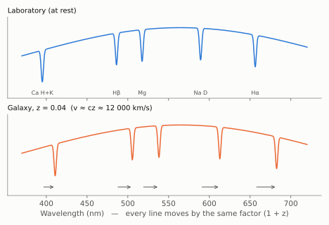
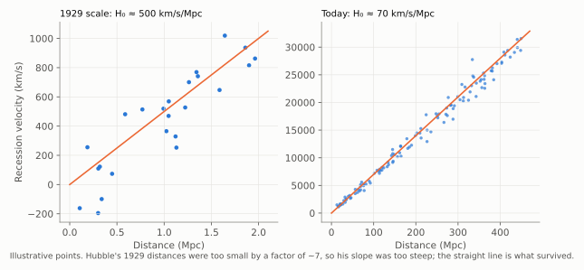
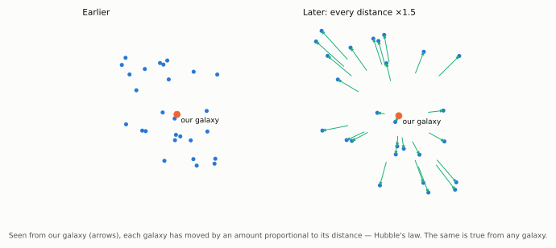
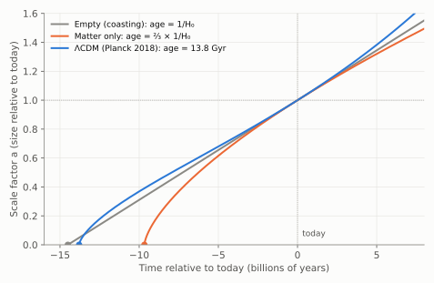

# Chapter 3: Expansion of the Universe

At the start of the 1920s it was still an open question whether the faint spiral "nebulae" were clouds of gas inside our own Milky Way or separate galaxies far beyond it. The question was settled with the tools of Chapter 2.

In 1923–24, using the 100-inch (2.5 m) Hooker telescope at Mount Wilson, Edwin Hubble found Cepheid variables in the Andromeda nebula, M31, and in other spirals. Their periods and faintness placed them far outside the Milky Way: the spirals were galaxies in their own right. (Hubble's distances were later revised upwards by Baade's correction; Andromeda is about 770 kpc, 2.5 million light-years, away.)

## 3.1 Redshifts

Since 1912, Vesto Slipher at Lowell Observatory had been measuring the spectra of spiral nebulae. He found that the absorption lines of most of them were shifted towards the red end of the spectrum, often by large amounts. The shift is described by the **redshift**

> **z = (λ_observed − λ_emitted) / λ_emitted**

Every line in the spectrum is shifted by the same *factor* (1 + z). This is how a redshift is distinguished from a change in the lines themselves. For small redshifts, the Doppler formula gives the velocity of recession: **v ≈ cz**.

*Figure 3.1. The same set of absorption lines, at rest in the laboratory (top) and in the spectrum of a galaxy with z = 0.04 (bottom). Each line moves to a longer wavelength by 4%. The pattern is unchanged, so the lines can still be identified.*

## 3.2 Hubble's Law

In 1929 Hubble combined Slipher's velocities, and new ones measured by Milton Humason, with his own Cepheid-based distances for 24 galaxies. Apart from a few nearby galaxies, all were receding. When velocity was plotted against distance, the points scattered about a straight line: **the recession velocity is proportional to the distance.**

> **v = H₀ d**

This is **Hubble's law**, and the constant of proportionality H₀ is the **Hubble constant**. (Georges Lemaître had derived the same relation from Einstein's equations and estimated its slope from published data in 1927, two years before Hubble. In 2018 the International Astronomical Union recommended the name **Hubble–Lemaître law**.)

*Figure 3.2. Hubble's law at the scale of the original 1929 data (left; galaxies within 2 Mpc, velocities up to about 1 000 km/s) and at the scale of modern data (right; hundreds of Mpc). The points are illustrative. Hubble's slope of about 500 km/s/Mpc was far too steep, because his distances were underestimated, but the straight-line relation survived every later test.*

Hubble's own value of H₀ was about 500 km/s/Mpc. The distances were too small, partly because of the Cepheid confusion described at the end of Chapter 2 and partly because some of the "brightest stars" he used in distant galaxies were really glowing clouds of ionised gas, far more luminous than any star. The modern value is close to **70 km/s/Mpc**. A galaxy 100 Mpc away recedes at about 7 000 km/s. (The small disagreement between methods about the exact value is one of the open problems of Chapter 11.)

## 3.3 What Hubble's Law Means

Hubble himself was cautious about drawing a grand conclusion from so few galaxies. The redshifts might not be Doppler shifts at all. Within two years, however, Humason had measured galaxies in distant clusters receding at nearly 20 000 km/s, and the straight line still held. The law was soon widely accepted.

A linear velocity–distance law has a remarkable property. It describes a Universe in which **every distance is growing by the same factor**, and it looks the same from every galaxy. Figure 3.3 shows why.

*Figure 3.3. Uniform expansion. Between the two panels every distance has grown by 50%. Measured from our galaxy, each other galaxy has moved by an amount proportional to its distance, which is Hubble's law. Choose any other galaxy as the centre and the same is true. Hubble's law does not put us at the centre of anything.*

The right picture is not of galaxies flying apart through a pre-existing space, but of **space itself stretching**, carrying the galaxies with it. It is described by a single **scale factor**, a(t), which multiplies all cosmic distances. In this picture the cosmological redshift is not really a Doppler shift. Light waves are stretched along with the space they travel through, so

> **1 + z = a(today) / a(when the light was emitted)**

A galaxy at redshift z = 1 is seen as it was when the Universe was half its present size.

## 3.4 The Age of the Universe

If the galaxies are moving apart now, they were closer together in the past. Run the expansion backwards and, at some finite time ago, all the matter in the observable Universe was packed extremely closely together. This is the seed of the Big Bang theory: **the Universe had a beginning in time.**

A first estimate of when is simple. If each galaxy has moved at constant speed v, then the time it took to reach its present distance d is

> t₀ = d / v = d / (H₀ d) = **1 / H₀**

The same for every galaxy. The quantity 1/H₀ is called the **Hubble time**. Converting units (1 Mpc = 3.086 × 10¹⁹ km):

> **1/H₀ = 977.8 / H₀ billion years** (H₀ in km/s/Mpc)

so H₀ = 70 gives **1/H₀ ≈ 14 billion years**. (Hubble's original value of 500 gave under 2 billion years, younger than the Earth. That embarrassment helped motivate the rival steady-state theory discussed in Part II.)

The true age differs from 1/H₀ because the expansion rate has not been constant. Gravity slows the expansion; dark energy (Chapter 11) speeds it up.

*Figure 3.4. How the size of the Universe changes with time in three models, all with the same expansion rate today. An empty universe coasts and its age is exactly 1/H₀. A universe containing only matter decelerates and is younger, ⅔ × 1/H₀. The observed Universe (ΛCDM) decelerated at first and has been accelerating for the last few billion years; by coincidence its age, 13.8 billion years, is close to 1/H₀.*

## 3.5 Mapping the Large-Scale Structure of the Universe

Because velocity and distance are proportional, and redshifts are easy to measure, the redshift itself is used as the distance indicator for remote galaxies. Measuring redshifts for many galaxies across a patch of sky gives a three-dimensional map of the Universe.

In the 1980s the Harvard–Smithsonian Center for Astrophysics (CfA) redshift survey produced the first such map, a thin slice of sky containing about 1 000 galaxies. It showed that galaxies are not spread evenly. They lie along filaments and on the walls of enormous **voids** some 50 Mpc across. In the centre of the CfA slice the Coma cluster forms the body of a famous "stick man".

Spectrographs fed by optical fibres, each fibre placed on one galaxy, now measure hundreds or thousands of redshifts in a single exposure. The 2dF Galaxy Redshift Survey (about 220 000 galaxies, completed 2003), the Sloan Digital Sky Survey (millions of galaxies) and the Dark Energy Spectroscopic Instrument (DESI, 5 000 fibres, operating since 2021) have mapped this **cosmic web** to distances of billions of light-years. On the very largest scales, above a few hundred megaparsecs, the Universe becomes smooth, as the Big Bang model assumes.
