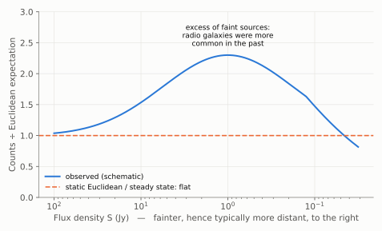

# Chapter 4: Distribution of Radio Galaxies and Quasars

## Two theories of an expanding Universe

By the late 1940s there were two ways to reconcile the expansion of Chapter 3 with the rest of physics.

- **The Big Bang theory**: the Universe began in a hot, dense state a finite time ago and has been expanding, cooling and changing ever since. The Universe of the past was different from the Universe of today.
- **The steady-state theory**, proposed in 1948 by Hermann Bondi, Thomas Gold and Fred Hoyle. It rests on the *perfect cosmological principle*: the Universe looks the same not only from every place but at every time. As galaxies move apart, new matter is continuously created to form new galaxies in the gaps, keeping the average density constant. Such a Universe has no beginning and does not evolve.

(The name "Big Bang" was coined by Hoyle in a 1949 BBC radio broadcast.)

The two theories make one sharply different prediction. In the steady state, the population of galaxies, averaged over large regions, must be **the same at all times**. Light from distant objects left them long ago, so looking far away is looking into the past. If distant galaxies are systematically different from nearby ones, the Universe has evolved, and the steady-state theory is wrong.

## Counting radio sources

After the Second World War, Martin Ryle and his colleagues at Cambridge began surveying the sky with radio telescopes. They catalogued thousands of radio sources, most of them **radio galaxies**: galaxies ejecting jets of fast-moving particles from their centres, which shine brightly at radio wavelengths.

The test is in the *counts*. Imagine sources with a fixed luminosity, spread uniformly through a static, unchanging Euclidean space. Sources brighter than flux *S* lie within a sphere of radius ∝ *S*^(−1/2). The number of such sources, N(>S), is proportional to the volume, so

> **N(>S) ∝ S^(−3/2)**

Any departure from this law means either that space is not Euclidean or that the sources were different in the past.

*Figure 4.1. Radio source counts divided by the static Euclidean expectation (schematic). A non-evolving population would lie on the flat line. The observed counts rise well above it at intermediate fluxes: there are too many faint, distant sources. At the faintest fluxes the counts fall again, because the expansion of the Universe dims and thins out the most distant sources.*

Ryle's counts, published through the 1950s and early 1960s, showed **too many faint sources**. Radio galaxies were more numerous, or more luminous, in the distant past than they are today. Expansion alone, in any model, makes the counts fall *below* the Euclidean line, not above it. So the excess of faint sources is a sign of evolution, and evolution contradicts the basic principle of the steady-state theory.

## Quasars

In 1963 Maarten Schmidt identified the radio source 3C 273 with a star-like object whose spectrum showed the hydrogen lines of a *galaxy* redshifted by z = 0.158. At the distance implied by Hubble's law it is hundreds of times more luminous than an entire galaxy like the Milky Way. These **quasars** ("quasi-stellar radio sources") are now known to be powered by gas falling into supermassive black holes at the centres of galaxies.

Quasars give the same verdict as radio galaxies, and more clearly. They are rare nearby and far more common at high redshift, with their numbers peaking at z ≈ 2, about 10 billion years ago. The Universe of the past contained objects that hardly exist today. **The Universe evolves**.

The steady-state theory was not given up immediately; the counts could be argued about. The decisive blow came in 1965, with the discovery described in Chapter 7.
