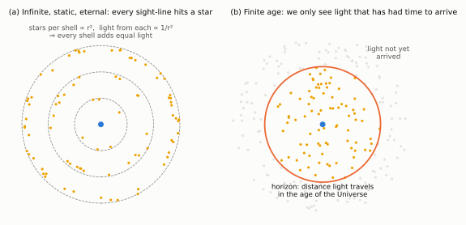

# Chapter 5: Olbers' Paradox and Its Resolution

Why is the sky dark at night?

The question sounds childish, but it has a long history. It was raised by Kepler in 1610 and by Edmond Halley and Jean-Philippe de Chéseaux in the 18th century, and is named after Heinrich Olbers, who discussed it in 1823. Its answer turns out to say something deep about the Universe.

## The paradox

Suppose the Universe is infinite in extent, unchanging and infinitely old, and filled uniformly with stars. Divide space into thin concentric shells centred on the Earth.

- The number of stars in a shell of radius *r* grows in proportion to its area, **∝ r²**.
- The light we receive from each of those stars falls off as **1/r²**.

The two effects cancel exactly: **every shell contributes the same amount of light**. With infinitely many shells, the total would be infinite. In fact nearer stars block the light of more distant ones behind them, so the true conclusion is that **every line of sight eventually ends on the surface of a star**. The whole sky should blaze as brightly as the surface of an average star, like the Sun's disk spread from horizon to horizon.

It is like standing in a large forest: in whatever direction you look, your line of sight eventually meets a tree trunk.

*Figure 5.1. (a) In an infinite, static, eternal universe, the number of stars in each shell (∝ r²) exactly compensates for their faintness (∝ 1/r²), and every line of sight ends on a star. (b) If the Universe has a finite age, we can only see stars within the distance light has travelled since they formed. Light from beyond this horizon has not yet reached us.*

## The resolution

As E. R. Harrison emphasised, conventional cosmology gives two independent ways out:

- **(a) The expansion of the Universe.** The cosmological redshift reduces the energy of each photon from a distant star, and stretches out the rate at which photons arrive. Distant stars therefore contribute less than the simple Euclidean argument assumes.
- **(b) A finite age.** If the stars have shone for only a finite time, light from stars beyond a certain distance has simply not had time to reach us, whatever the expansion is doing.

Harrison's calculations showed that **(b) is by far the more important**. Expansion reduces the brightness of the night sky only by a factor of about two compared with a static universe of the same age. The sky is dark mainly because the Universe, and the stars in it, have not existed long enough to fill space with light. Even within our horizon, there are far too few stars, shining for far too short a time, to cover the sky. Stars burn for billions of years, but the time it would take for their light to fill the Universe is around 10²³ years.

(A finite age as the answer was first suggested, remarkably, by the writer Edgar Allan Poe, in his prose poem *Eureka* of 1848.)

## Why this matters for the Big Bang

In the **steady-state** theory, the Universe is infinitely old, so only the expansion argument is available. (It does work there, because a steady-state universe has been expanding forever, and that limits how much light distant sources can contribute.) In the **Big Bang** theory, expansion and a finite age go hand in hand. The dark night sky, the most ordinary observation of all, is evidence that the Universe has a history.
