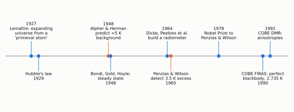

# Chapter 6: The Prediction of Cosmic Background Radiation

## Gamow's hot Big Bang

In the late 1940s George Gamow, with his students Ralph Alpher and Robert Herman, asked where the chemical elements came from. Their idea was that the elements were built up by nuclear reactions in the first minutes after the Big Bang, when the whole Universe was as hot as the core of a star.

For nuclear reactions to proceed fast enough, before the rapid expansion of the early Universe thinned the matter out, the Universe must have started at an extremely high temperature. Matter that hot would be filled with **thermal radiation**, and in the early Universe the energy density of this radiation would greatly exceed that of the matter.

Gamow's hope that *all* the elements were made this way turned out to be wrong. There is no stable nucleus with mass 5 or mass 8, so the build-up of heavier nuclei by adding one particle at a time stalls at helium, apart from a trace of lithium. The heavier elements were made much later, inside stars and stellar explosions (Burbidge, Burbidge, Fowler and Hoyle, 1957). But the hot early Universe was right, and so was its most important consequence.

## A relic radiation

As the Universe expanded, both matter and radiation cooled. After a time the matter became too cool and too thin for further nuclear reactions. Later still (we now know it was about 380 000 years after the beginning), the temperature fell to about 3 000 K. At that point electrons and nuclei combined into neutral atoms, and the Universe became transparent. From then on the radiation was no longer in contact with matter and simply travelled freely through space.

As the Universe continued to expand, each photon was redshifted. It can be shown that radiation which starts with a thermal (blackbody) spectrum keeps a perfect blackbody spectrum as it is redshifted, but with a temperature that falls in proportion to the expansion:

> **T ∝ 1/a**, i.e. T(today) = T(then) / (1 + z)

So the Universe today should be filled with blackbody radiation at a temperature only a few degrees above absolute zero. At such temperatures the radiation is at microwave wavelengths.

*Figure 6.1. From prediction to discovery. The background was predicted in 1948 but not searched for until the mid-1960s, when it was found by accident.*

## Predictions, forgotten and remade

In 1948 Alpher and Herman estimated that the present temperature of this radiation should be about **5 K**. Gamow's own estimates over the following years varied, some reaching tens of kelvin. No-one at the time took up the challenge of looking for the radiation. Many radio astronomers did not know of the prediction, and those who did assumed it was too faint to detect against other sources of noise. The prediction was largely forgotten.

In the early 1960s it was rediscovered independently. At Princeton, Robert Dicke and Jim Peebles were reconsidering the hot Big Bang. One of their reasons was that stars did not seem able to produce the observed abundance of helium (Chapter 9). Peebles calculated that the present radiation temperature should be a few kelvin. Dicke, with Peter Roll and David Wilkinson, set out to build a radiometer to detect it. They were beaten to the discovery, as the next chapter tells, by a few months and by about 50 km.

(Peebles received the Nobel Prize in Physics in 2019 for his theoretical work in cosmology.)
