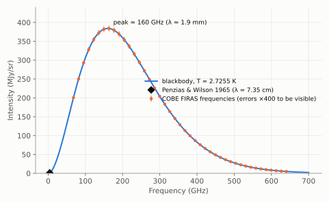

# Chapter 7: The Discovery of the Cosmic Microwave Background

## An unexplained hiss

In 1964 Arno Penzias and Robert Wilson, two radio astronomers at Bell Telephone Laboratories in Holmdel, New Jersey, were preparing a 6-metre horn antenna for radio astronomy. The antenna had originally been built for early satellite communication experiments. They intended to use it for precise measurements of radio emission from our Galaxy, so they first needed to account for every source of noise in their equipment.

Working at a wavelength of 7.35 cm (4.08 GHz), they found a small excess of noise, equivalent to a temperature of about 3.5 K, that would not go away. It was the same in every direction, at every time of day and in every season. They checked the electronics and pointed the antenna away from cities. They even evicted a pair of pigeons nesting in the horn and cleaned out what they politely called "white dielectric material". The excess remained.

## The connection is made

Penzias mentioned the puzzle to Bernard Burke of MIT. Burke had heard about a talk by Jim Peebles predicting a background of radiation at a few kelvin, and put the two groups in touch. Dicke's group, only about 50 km away in Princeton, came to Holmdel, saw the data, and recognised that they had been scooped.

In 1965 the two groups published companion papers in the *Astrophysical Journal*: Penzias and Wilson reporting "excess antenna temperature" at 4 080 Mc/s, and Dicke, Peebles, Roll and Wilkinson explaining it as cosmic blackbody radiation left over from the hot Big Bang.

The **cosmic microwave background (CMB)** was exactly what the hot Big Bang theory had predicted. The steady-state theory had no natural way to produce it, a uniform blackbody glow filling all of space. Its discovery was the decisive blow to the steady-state theory. Penzias and Wilson were awarded the Nobel Prize in Physics in 1978.

## A perfect blackbody

One measurement at one wavelength does not show that the radiation is a blackbody. That required measurements across the spectrum, especially at millimetre wavelengths near the peak, which are absorbed by the atmosphere. Through the 1970s and 1980s measurements from mountains, balloons and rockets gave temperatures of roughly 2.7–3 K, but with confusing discrepancies.

The question was settled by NASA's **Cosmic Background Explorer (COBE)** satellite. In 1990, after just nine minutes of observation, its FIRAS instrument showed a spectrum that matched a blackbody so perfectly that the data points lay on the theoretical curve. The audience at the American Astronomical Society meeting gave the slide a standing ovation. The final analysis gives

> **T = 2.7255 ± 0.0006 K**

and limits any departure from a pure blackbody to less than 50 parts per million. It is the most perfect blackbody spectrum ever measured in nature.

*Figure 7.1. The spectrum of the cosmic microwave background. The curve is a blackbody at 2.7255 K, peaking at about 160 GHz (a wavelength of about 2 mm). The points mark the frequencies measured by COBE's FIRAS instrument; the real error bars are far too small to see, so here they are drawn 400 times larger. The diamond marks the single wavelength of Penzias and Wilson's discovery, far down on the long-wavelength side of the peak.*

## Ripples

The CMB is almost, but not quite, the same in every direction. COBE's DMR instrument found in 1992 that its temperature varies from place to place by about **1 part in 100 000**. These tiny ripples are the imprint of slight variations in density in the early Universe. Gravity later amplified them into the galaxies and clusters of the cosmic web (Chapter 3). John Mather and George Smoot shared the 2006 Nobel Prize in Physics for COBE's results. Mapping the ripples in detail has since become one of the most powerful tools in cosmology (Chapter 11).

There are about **410 CMB photons in every cubic centimetre** of space. A small fraction of the "snow" on an old analogue television tuned between stations came from the Big Bang.
