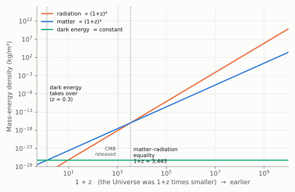
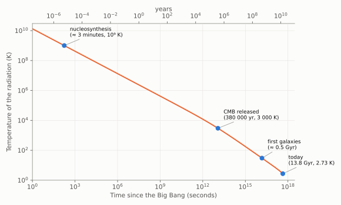

# Chapter 8: The Hot Big Bang

We now follow the theoretical consequences of the Penzias–Wilson discovery backwards in time.

## Radiation in an expanding Universe

The wavelength λ_max at which blackbody radiation is brightest is fixed by its temperature, through **Wien's displacement law**:

> **λ_max × T = 2.898 mm·K**

As the Universe expands, every wavelength is stretched in proportion to the scale factor a(t) (Chapter 3):

> **λ_max ∝ a**

So the temperature of the radiation must fall as the Universe expands:

> **T_rad ∝ 1/a**

At redshift z, when the Universe was 1 + z times smaller, the radiation was 1 + z times hotter: **T = 2.7255 K × (1 + z)**.

## Radiation versus matter

How do the energy densities of radiation and matter change with the expansion? (Energy density is expressed as an equivalent mass density through E = mc².)

- **Matter.** The number of particles is fixed, and their volume grows as a³. So **ρ_m ∝ a⁻³**.
- **Radiation.** The number of photons per unit volume also falls as a⁻³. In addition, each photon's wavelength is stretched, so its energy falls as a⁻¹. So **ρ_rad ∝ a⁻⁴**.

The ratio is **ρ_rad / ρ_m ∝ 1/a**. Radiation becomes relatively more important the further back we go.

Today matter dominates. Counting *all* the matter (including the dark matter of Chapter 11), and including the neutrinos that accompany the photons, radiation makes up only about 1/3 400 of the energy density of matter. So at a redshift of about **3 400**, when the Universe was some 3 400 times smaller than now and about 50 000 years old, the two were equal. Before that the Universe was **radiation-dominated**.

*Figure 8.1. The mass-energy density of radiation, matter and dark energy as the Universe expands, plotted against 1 + z. Going back in time is moving to the right. Radiation (∝ (1 + z)⁴) rises fastest and overtakes matter at 1 + z ≈ 3 400. Dark energy, constant per unit volume, only became dominant in the last few billion years (Chapter 11).*

## The thermal history

Following the temperature backwards gives the outline of cosmic history.

*Figure 8.2. The temperature of the cosmic radiation against time since the Big Bang, calculated for the Planck 2018 cosmology. Note the logarithmic scales: the first three minutes and the last 13.8 billion years appear on the same chart.*

- **Today, 13.8 billion years:** 2.7 K. Galaxies, stars, planets.
- **About 380 000 years:** about 3 000 K, at z ≈ 1 100. Electrons and nuclei combine into atoms (*recombination*); the Universe becomes transparent and the CMB is released. Before this time the Universe was an opaque, glowing plasma, like the inside of a star. The CMB is a picture of the surface where it became transparent.
- **About 50 000 years:** matter and radiation densities equal.
- **A few minutes:** about 10⁹ K. The light nuclei are formed (Chapter 9).
- **One second:** about 10¹⁰ K. Neutrinos stop interacting and stream away freely.
- **Earlier still:** temperatures and densities beyond anything reachable in laboratories, where our knowledge of physics becomes increasingly uncertain.

There are about **1.6 billion photons for every proton or neutron** in the Universe. This enormous ratio is fixed by the expansion; it has hardly changed since the first second. It will matter in the next chapter.

## What "Big Bang" does and does not mean

The early Universe was hot, dense and dominated by radiation: it was exceedingly bright. From that state it has expanded and cooled ever since, and as galaxies formed they too were carried along by the expansion.

It is tempting to picture this as an explosion: a lump of matter at a point, bursting outwards into empty space. **That picture is wrong**, and the name "Big Bang" encourages it.

- There is **no centre**. As Figure 3.3 showed, every galaxy sees all the others receding in the same way.
- There is **no outside**. The Big Bang did not happen at a place within space; it happened *everywhere*. At early times all of space, possibly infinite, was hot and dense, and all of space has been expanding since.
- What the theory describes is the **expansion of space**, starting from a hot, dense state. It does not describe a "moment of creation". As we follow time back towards the very beginning, densities and temperatures increase without limit, and general relativity, which does not include quantum effects, ceases to be reliable. What happened at "t = 0", if anything, is still unknown.
