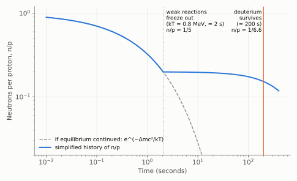
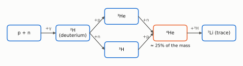

# Chapter 9: Big Bang Nucleosynthesis

*The helium abundance: a confirmation of the Big Bang theory*

About a quarter of the mass of ordinary matter in the Universe is helium. It is found in roughly that proportion everywhere: in old stars and young, in our Galaxy and in distant ones. Stars do make helium by fusing hydrogen, but all the stars that have ever shone could have made only a few per cent. The rest must have been made before there were any stars. This chapter shows that the hot Big Bang predicts almost exactly the amount observed. The calculation is simple enough to do in a few lines.

## The first second: neutrons and protons in equilibrium

At temperatures above about 10¹² K (in the first hundredth of a second or so), pairs of particles and antiparticles were continually being created from radiation and annihilating back into it. As the temperature fell, the pairs annihilated. Because of a slight excess of matter over antimatter, about one part in a billion, a small residue of protons and neutrons was left over. Everything made of ordinary matter today comes from this residue.

These protons and neutrons were bathed in an intense sea of electrons, positrons, neutrinos and photons. Weak nuclear reactions continually converted protons into neutrons and back again:

> p + e⁻ ⇌ n + ν
>
> p + ν̄ ⇌ n + e⁺

While these reactions are fast, the neutrons and protons are in thermal equilibrium. The neutron is slightly heavier than the proton (Δm c² = (m_n − m_p)c² = 1.293 MeV), so making a neutron costs energy, and their relative numbers follow the Boltzmann law:

> **n / p = exp[ −(m_n − m_p) c² / kT ]**

At T = 10¹⁰ K, kT = 0.86 MeV, and the formula gives n/p = e^(−1.5) ≈ 0.22, **about one neutron for every five protons**. As the temperature continues to fall, the equilibrium ratio would keep falling towards zero.

## Freeze-out

But the weak reactions depend steeply on temperature. When the Universe is about a second old (kT ≈ 0.8 MeV), they become too slow to keep up with the expansion; the neutrinos effectively stop interacting. The conversion of protons into neutrons stops and **the ratio freezes at n/p ≈ 1/5**.

From then on, the only process changing the number of neutrons is their own radioactive decay:

> n → p + e⁻ + ν̄   (mean lifetime 879 s, nearly 15 minutes)

*Figure 9.1. A simplified history of the neutron-to-proton ratio. At first it follows thermal equilibrium (dashed line). It freezes out at about 1/5 when the weak reactions stop, then slowly falls as free neutrons decay, until they are locked safely into nuclei at about 200 seconds.*

## The deuterium bottleneck

The first step towards helium is the formation of deuterium (heavy hydrogen):

> n + p → ²H + γ

The deuteron is fragile: its binding energy is only 2.2 MeV. Even when the typical photon energy is far below this, there are **1.6 billion photons for every nucleon** (Chapter 8). The rare photons in the high-energy tail of the blackbody spectrum are still numerous enough to break up every deuteron as soon as it forms. Deuterium can survive only when the temperature has fallen below about 10⁹ K, at an age of about **3 minutes (≈ 200 s)**.

During this delay neutrons continue to decay, and n/p falls from about 1/5 to about **1/7**. (The simplified model of Figure 9.1, with an abrupt freeze-out, gives 1/6.5. In the full calculation freeze-out is gradual, and the ratio ends close to 1/7.)

## Making helium

Once deuterium survives, a rapid chain of reactions converts almost all of it into helium-4, the most tightly bound light nucleus:

*Figure 9.2. The main reactions of Big Bang nucleosynthesis. Almost every neutron ends up in helium-4. The absence of stable nuclei with mass 5 or 8 blocks the path to heavier elements, leaving only a trace of lithium-7.*

Each helium-4 nucleus contains 2 neutrons and 2 protons, and essentially every surviving neutron ends up in one. So the fraction of the mass that becomes helium, *Y*, is simply:

> **Y = (mass in helium) / (total mass) = 2 (n/p) / (1 + n/p)**

Check with a concrete count. With n/p = 1/7, take 2 neutrons and 14 protons. The 2 neutrons combine with 2 of the protons to make one helium-4 nucleus, of mass 4. The remaining 12 protons are hydrogen. The total mass is 16, so

> **Y = 4/16 = 25%**

Had we ignored neutron decay and used n/p = 1/5, we would have obtained 2 neutrons + 10 protons → Y = 4/12 ≈ 33%. That is too high: the decay of neutrons during the deuterium bottleneck is exactly what brings the answer down to 25%.

A full computer calculation, following every reaction rate and using the measured density of ordinary matter, gives **Y = 0.247**.

## Comparison with observation

To measure the *primordial* helium abundance, astronomers look at the least-processed gas they can find: clouds of ionised gas in small galaxies that have formed very few stars and contain very few heavy elements. The result is **Y = 0.245 ± 0.003**, in remarkable agreement with the prediction.

The Big Bang also leaves traces of other light nuclei, whose abundances depend on how dense ordinary matter was:

| Nucleus | Predicted (relative to hydrogen) | Observed |
|---|---|---|
| ⁴He (mass fraction Y) | 0.247 | 0.245 ± 0.003 |
| Deuterium, D/H | 2.5 × 10⁻⁵ | (2.53 ± 0.03) × 10⁻⁵ |
| ³He/H | ~1 × 10⁻⁵ | ~1 × 10⁻⁵ |
| ⁷Li/H | ~5 × 10⁻¹⁰ | ~1.6 × 10⁻¹⁰ |

Deuterium is a particularly sensitive "baryometer". Stars only destroy it, so any deuterium we see today was made in the Big Bang, and the amount made falls steeply as the matter density rises. The measured D/H fixes the density of ordinary matter at about **5% of the critical density**, independently of any other method. This agrees with the value deduced from the CMB ripples (Chapter 11). It is also far less than the total amount of matter, which is strong evidence that most matter is not made of protons and neutrons at all.

Lithium-7 is the exception: the observed abundance in old stars is about three times lower than predicted. Whether this "lithium problem" points to new physics or, more probably, to lithium being destroyed in the stars themselves is still being investigated.

Agreement between theory and observation across nine orders of magnitude in abundance, from helium at 25% to lithium at a part in ten billion, is one of the great successes of the Big Bang theory. Together with the expansion (Chapter 3), the evolution of the Universe (Chapter 4) and the cosmic microwave background (Chapter 7), it forms the observational foundation of modern cosmology.
