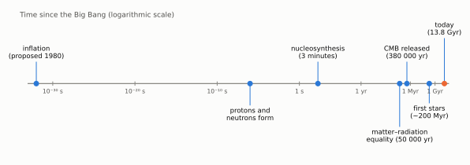
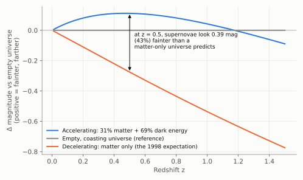
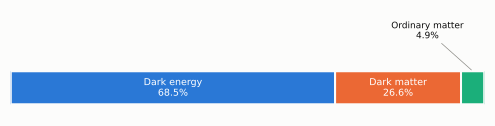
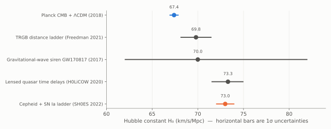

# Chapter 11: The Universe Since 1998

The first edition of this book was written in 1998. That year, cosmology changed. This chapter describes what has been learned since. The broad picture of Chapters 1–10 has survived intact, but it has been measured with a precision that would have seemed impossible then, and it has acquired some deep new puzzles.

*Figure 11.1. Cosmic history on a logarithmic time scale, as it is understood today.*

## 11.1 The accelerating Universe

In 1998 everyone expected the expansion of the Universe to be **slowing down**, because the gravity of everything in it pulls everything else back. The open question was by how much. Two teams set out to measure the slowing using **Type Ia supernovae**: exploding white dwarf stars that, once a correction is made for the shape of their light curves, all reach nearly the same peak luminosity. They are standard candles bright enough to be seen across billions of light-years, and they extend the distance ladder of Chapter 2 by another rung.

If the expansion had been slowing, distant galaxies would have been receding faster in the past, and supernovae at a given redshift would be relatively *close* and bright. Both the High-z Supernova Search Team (Adam Riess, Brian Schmidt and colleagues) and the Supernova Cosmology Project (Saul Perlmutter and colleagues) found the opposite. **The distant supernovae were fainter, so farther away, than expected. The expansion is speeding up.**

*Figure 11.2. How the brightness of a standard candle depends on redshift in different universes, relative to an empty, coasting universe. In a matter-only universe (orange) the expansion decelerates and distant supernovae appear brighter. The observations follow the blue curve: a universe whose expansion began to accelerate about 6 billion years ago.*

Something with a strange property is needed to drive the acceleration: its density stays nearly constant as space expands, and its gravitational effect is repulsive. It has been named **dark energy**. The simplest candidate is Einstein's **cosmological constant**, Λ, which he introduced in 1917 and later abandoned: an energy belonging to empty space itself. Perlmutter, Schmidt and Riess shared the 2011 Nobel Prize in Physics.

Why the vacuum should have this energy, and why it is so small (quantum theory naively predicts a value 10¹²⁰ times too large), is perhaps the deepest unsolved problem in physics.

## 11.2 Precision cosmology from the CMB ripples

The temperature ripples in the cosmic microwave background, first detected by COBE in 1992 (Chapter 7), have since been mapped in great detail: by balloon experiments in the late 1990s, by NASA's WMAP satellite (2001–2010), by ESA's Planck satellite (2009–2013), and by ground-based telescopes in Chile and at the South Pole.

The ripples are the imprint of sound waves that travelled through the hot plasma of the early Universe before it became transparent at 380 000 years. The characteristic size of the ripples on the sky is a ruler of known length at a known distance. It shows that **space is geometrically flat** to within less than 1%. The detailed pattern fixes the contents of the Universe precisely. The same sound waves left a faint preferred separation of about 150 Mpc between galaxies, the **baryon acoustic oscillation** scale, which was found in galaxy surveys in 2005 and has become another standard ruler.

From Planck and these other measurements:

| Quantity | Value |
|---|---|
| Age of the Universe | 13.787 ± 0.020 billion years |
| Hubble constant (inferred) | 67.4 ± 0.5 km/s/Mpc |
| CMB temperature | 2.7255 K |
| Geometry | flat |

*Figure 11.3. The contents of the Universe today, by energy density. Everything ever seen through a telescope, all the stars, gas, planets and people, is in the small aqua slice.*

## 11.3 Dark matter

The "missing mass" mentioned in the 1998 conclusion has a long history. Fritz Zwicky found in 1933 that the galaxies in the Coma cluster move too fast to be held together by the visible matter. In the 1970s Vera Rubin and others found the same in the rotation of individual spiral galaxies.

The evidence is now overwhelming and comes from many independent directions: the CMB ripples, the bending of light by clusters of galaxies (gravitational lensing), the growth of the cosmic web, and colliding galaxy clusters such as the Bullet Cluster, where the mass is clearly separated from the visible gas. Combined with the nucleosynthesis limit on ordinary matter (Chapter 9), this shows that about **85% of the matter in the Universe is not made of atoms**. It does not emit or absorb light and interacts, as far as we know, only through gravity. What it is remains unknown. Decades of increasingly sensitive laboratory searches have not yet detected a dark-matter particle.

## 11.4 The Hubble tension

The distance ladder of Chapter 2 has been rebuilt with modern tools: Gaia parallaxes, Hubble Space Telescope (and now JWST) observations of Cepheids, and Type Ia supernovae. It gives **H₀ ≈ 73 km/s/Mpc**. Planck's measurement of the early Universe, extrapolated to today using the standard model, gives **67.4 km/s/Mpc**. The uncertainties are now so small that the difference is significant at about the 5σ level.

*Figure 11.4. A selection of measurements of the Hubble constant. The early-Universe prediction (blue) and the Cepheid–supernova distance ladder (orange) disagree; other methods fall in between or are not yet precise enough to decide.*

Either some systematic error is hiding in one of the measurements, or the standard cosmological model is missing something. This question, about the same constant Hubble first measured in 1929, is one of the most active in cosmology today.

## 11.5 Is dark energy changing?

If dark energy is Einstein's cosmological constant, its density never changes. Recent results from the DESI galaxy survey, combined with the CMB and supernovae, have hinted that dark energy may instead be slowly weakening with time. The evidence is not yet decisive. If confirmed, it would mean that dark energy is not a constant of nature, but something dynamic.

## 11.6 New windows

- **Gaia** (launched 2013) has measured parallaxes and motions for over a billion stars of our Galaxy, putting the bottom rung of the distance ladder on a new footing.
- **Gravitational waves**, ripples in space-time itself, were detected by LIGO in 2015 from a pair of merging black holes (Nobel Prize 2017). In 2017 a merger of two neutron stars was seen both in gravitational waves and in light. The gravitational waves gave its distance directly, without any distance ladder, and the light gave its redshift, providing a completely independent measurement of H₀ (Figure 11.4). Such "standard sirens" may one day help resolve the Hubble tension.
- **The James Webb Space Telescope** (launched 2021) observes in the infrared, where the light of the most distant galaxies has been redshifted. It has found galaxies at redshifts beyond 14, seen less than 300 million years after the Big Bang. Many are more luminous and more mature than expected, and astronomers are still working out why.

## 11.7 Before the hot Big Bang: inflation

The hot Big Bang leaves some questions unanswered. Why is space so flat? Why is the CMB the same temperature in regions that, according to the simple theory, could never have been in contact? Where did the tiny ripples come from?

The theory of **inflation**, proposed by Alan Guth in 1980 and developed by Andrei Linde, Andreas Albrecht and Paul Steinhardt, among others, suggests that in a tiny fraction of a second before the hot Big Bang, space expanded exponentially by an enormous factor. This would have flattened space, smoothed it out, and stretched microscopic quantum fluctuations into the seeds of galaxies. The detailed statistics of the CMB ripples match inflation's predictions well. Its most distinctive signature, a pattern in the polarisation of the CMB produced by primordial gravitational waves, has not yet been detected. (A claimed detection in 2014 turned out to be caused by dust in our own Galaxy.)

## 11.8 The picture today

The standard model of cosmology, called **ΛCDM** (Lambda, for dark energy, plus Cold Dark Matter), describes an enormous range of observations with just six numbers. It is the hot Big Bang of this book, made precise. Yet 95% of its content, dark matter and dark energy, is of unknown nature. In 1998 the conclusion of this book said: "the more we learn, the more we find there is to learn." Nearly three decades of discovery have proved it right.
